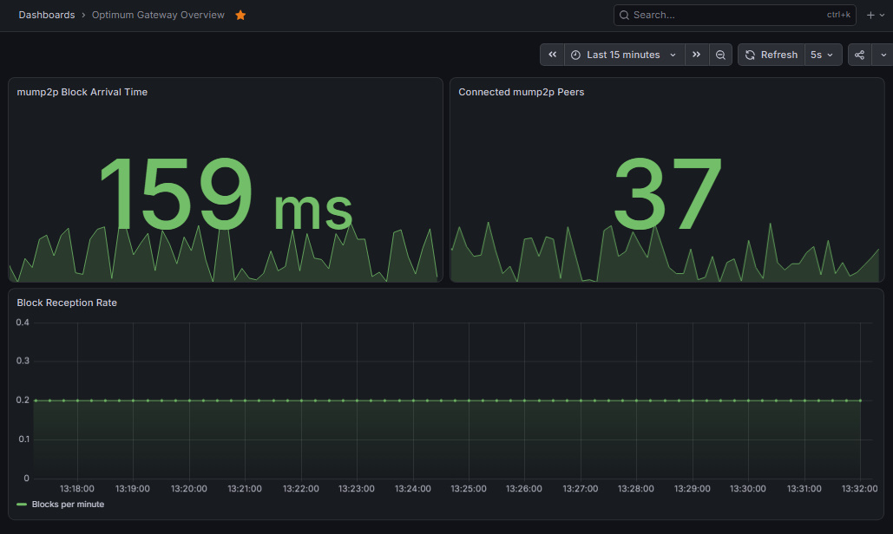

# Optimum Gateway Prometheus Exporter

A lightweight, production-ready Prometheus exporter for the [Optimum Gateway](https://getoptimum.xyz/). 

This tool exposes real-time, node-specific `mump2p` network metrics, allowing Ethereum node operators and staking providers to monitor block propagation latency, peer connectivity, and MEV bid cutoffs directly within their existing Grafana/Prometheus observability stacks.

## 🚀 Why Use This?

While the [Optimum Hub](https://hub.getoptimum.xyz/) provides excellent *network-wide* aggregate statistics, node operators need *local, node-specific* observability to:
- **Verify ROI**: Prove that mump2p is actually reducing block arrival latency on your specific hardware.
- **Set Alerts**: Trigger PagerDuty/Slack alerts if `mump2p` peer connections drop to zero.
- **Troubleshoot**: Correlate missed attestations or MEV leaks with local network propagation spikes.

## ⚡ Quick Start (Docker Compose)

The fastest way to get started is using the provided `docker-compose.yml`, which spins up the Exporter, Prometheus, and Grafana in one command.

1. Clone the repository:
   git clone https://github.com/RMNAi/optimum-exporter.git
   cd optimum-exporter

2. Start the stack:
   docker-compose up -d

3. Access the services:
   - Exporter Metrics: http://localhost:9100/metrics
   - Prometheus: http://localhost:9090
   - Grafana: http://localhost:3000 (Default credentials: admin / admin)

## 📊 Grafana Dashboard

A professional, pre-configured Grafana dashboard is included to visualize your metrics immediately.

1. Log into Grafana (http://localhost:3000).
2. Add Prometheus as a Data Source:
   - URL: `http://prometheus:9090`
   - Click **Save & Test**.
3. Import the dashboard:
   - Go to **Dashboards** -> **New** -> **Import**.
   - Upload the `dashboard.json` file from this repository (or paste its contents).
   - Select your Prometheus data source and click **Import**.

## 📈 Exposed Metrics

| Metric Name | Type | Description |
| :--- | :--- | :--- |
| `optimum_gateway_peers_connected` | Gauge | Current number of active mump2p peer connections. |
| `optimum_gateway_block_arrival_ms` | Gauge | Latency (in milliseconds) for the latest block to arrive via mump2p. |
| `optimum_gateway_blocks_received_total` | Counter | Total cumulative number of blocks successfully received via the mump2p network. |

*(Note: Standard Go runtime and process metrics are also exposed by default for exporter health monitoring).*

## 🛠️ Local Development (Without Docker)

If you prefer to run the exporter natively:

1. Download dependencies:
   go mod download

2. Run the exporter:
   go run main.go

The exporter will start and expose metrics on `http://localhost:9100/metrics`.

## 🤝 Contributing

Contributions are welcome! If you have ideas for additional metrics (e.g., RLNC shard recovery rates, MEV bid cutoff integration), please open an Issue or submit a Pull Request.

## 📜 License

This project is licensed under the MIT License. See the [LICENSE](LICENSE) file for details.