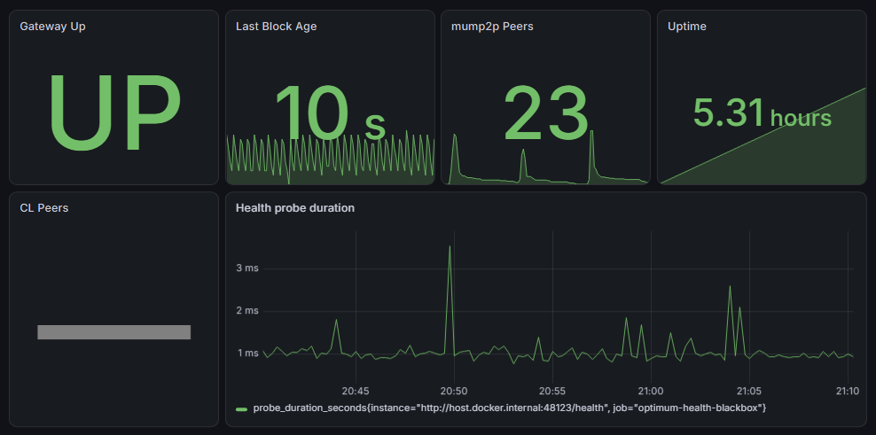

# Optimum Gateway Observability (native)

Observability pack for the Optimum Gateway sidecar (mump2p / RLNC block
propagation), built entirely on the gateway's OWN telemetry plus two
off-the-shelf exporters. No custom code to audit or maintain. (The mock in tests/ is CI-only; nothing custom runs in the monitoring path.)

## Scope (read this first)

This pack provides LIVENESS and STALL detection: is the gateway alive,
meshed, and receiving blocks? It does NOT measure arrival-latency deltas
and does NOT prove ROI vs gossipsub. `last_block_age_sec` is a freshness
gauge, not a latency measurement. For per-validator performance / ROI
(attestation accuracy, block inclusion, acceleration recommendations) use
the Optimum Console. This pack complements the Console; it does not replace it.

## Prerequisites

- Docker and Docker Compose installed
- A running Optimum Gateway with telemetry enabled on port 48123 (the default). If you enrolled via the Optimum Console, telemetry is already enabled.
- The gateway's telemetry port (`48123`) must be reachable from this monitoring stack.

## Why native

The gateway already exposes:
  GET /metrics   Prometheus metrics (telemetry_enable: true)
  GET /health    structured health, 200 healthy / 503 degraded
So we scrape /metrics directly, probe /health with blackbox_exporter
(probe_success is the trustworthy up/health signal), and lift the numeric
/health fields with json_exporter. Zero custom exporter code.

Sources -> signals:
  blackbox_exporter  /health   -> probe_success, probe_duration_seconds
  json_exporter      /health   -> optimum_last_block_age_seconds,
                                  optimum_mump2p_peers, optimum_uptime_seconds
  gateway            /metrics  -> the gateway's own operational metrics

## Quickstart (evaluation)

Requires a running Optimum Gateway with telemetry on port 48123.

    docker compose up -d

Open Grafana (http://localhost:3000, admin/admin). The datasource and the
dashboard are auto-provisioned into the "Optimum" folder. Prometheus is at
http://localhost:9090. All ports bind to loopback; this stack is for local
evaluation only — do not run it on a validator host.

## Production

Add the three scrape jobs from prometheus/prometheus.yml to your EXISTING
Prometheus, load prometheus/alerts.yml as rule_files, and import
dashboards/optimum.json into your EXISTING Grafana. Or run only Grafana
against your Prometheus:

    cp .env.example .env    # set PROMETHEUS_URL + a real admin password
    docker compose -f docker-compose.grafana.yml up -d

Keep .env out of git. Put Grafana behind TLS; never expose :3000 publicly.

## Remote Gateways

By default, this stack monitors a gateway running on the same machine (`host.docker.internal:48123`). 

If your gateway runs on a different server, edit `prometheus/prometheus.yml` and replace `host.docker.internal` with your gateway's IP address or hostname in all three scrape jobs (the lines containing `targets:`).

## Alerts

| Alert | Condition | Severity |
| --- | --- | --- |
| `OptimumGatewayDown` | no HTTP response for 2m | critical |
| `OptimumGatewayDegraded` | `/health` 503 for 2m | warning |
| `OptimumBlockFlowStalled` | `last_block_age_seconds > 60` for 2m | warning |
| `OptimumMeshPeersLow` | `mump2p_peers < 3` for 5m | warning |
| `OptimumCLPeersZero` | `optimum_cl_peers < 1` for 5m | warning |
| `OptimumGatewayRestarted` | uptime reset within 1h | info |

json_exporter accepts 200 and 503, so gauges keep updating while the gateway is degraded. When the gateway is unreachable, the series disappear and panels render "—" (unknown) rather than a stale value. Blackbox distinguishes the two: status 0 = down, 503 = degraded.

Tested against gateway v1.3.4 in stream-only mode. On stream-only nodes /health skips the CL checks, so the CL-peers alert stays silent and the panel shows "—" rather than a false zero.

## Security

Read-only GETs to the local gateway only. No validator keys, no outbound
calls beyond the gateway and your Prometheus. Keep the gateway telemetry
listener and all metrics ports bound to loopback / a monitoring VLAN.
Pin image digests and canary on one host before fleet rollout. See SECURITY.md.

## Repository layout

  prometheus/        scrape jobs + alert rules
  blackbox/          http_2xx module for /health
  json_exporter/     /health field extraction
  grafana/           datasource + dashboard provisioning
  dashboards/        the Grafana dashboard
  docker-compose.yml           evaluation stack
  docker-compose.grafana.yml   production Grafana vs external Prometheus

## Validation

    docker compose config -q
    docker run --rm -v "$PWD/prometheus:/p" --entrypoint /bin/promtool prom/prometheus:v3.13.3 \
      check config /p/prometheus.yml
    docker run --rm -v "$PWD/prometheus:/p" --entrypoint /bin/promtool prom/prometheus:v3.13.3 \
      check rules /p/alerts.yml    

CI runs these on every push/PR.
CI also runs tests/smoke.sh: json_exporter against committed /health fixtures (stream-only, CL-healthy, stall-503, CL-fail-503), captured from gateway v1.3.4.

## License

MIT. See LICENSE.